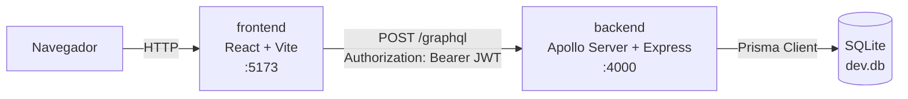
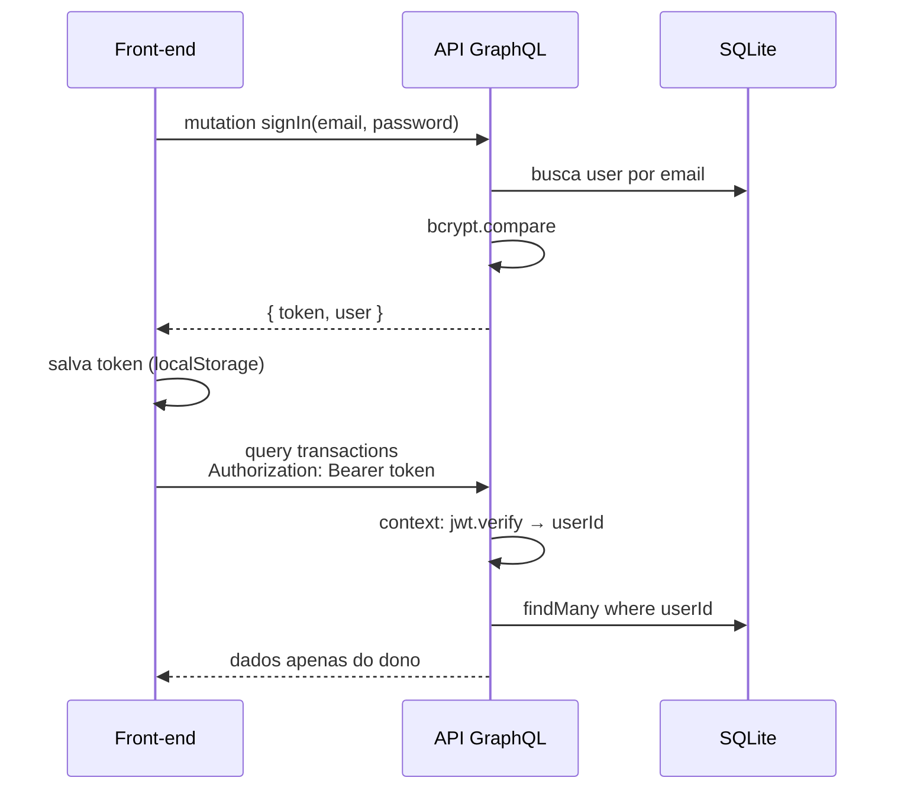

# 02 — Arquitetura

## Visão de alto nível



## Stack

### Back-end (`backend/`)

| Camada | Tecnologia | Motivo |
|---|---|---|
| Runtime | Node.js 22+ | LTS; `--env-file` nativo |
| Linguagem | TypeScript 5 | Obrigatório (RNF-01) |
| HTTP | Express 4 + `cors` | Integração oficial do Apollo; CORS (RNF-04) |
| GraphQL | Apollo Server 4, **SDL-first** | Obrigatório (RNF-02); ver [ADR-0002](adr/0002-graphql-sdl-first.md) |
| ORM | Prisma 6 | Obrigatório (RNF-03) |
| Banco | SQLite | Obrigatório (RNF-03) |
| Auth | `jsonwebtoken` + `bcryptjs` | JWT stateless; hash de senha |
| Validação | Zod 3 | RNF-09 |
| Dev | `tsx watch` | Hot reload sem build |

### Front-end (`frontend/`)

| Camada | Tecnologia | Motivo |
|---|---|---|
| Bundler | Vite 6 | Obrigatório (RNF-07) |
| UI | React 19 + TypeScript | Obrigatório |
| GraphQL | Apollo Client 3 | Cache normalizado, `refetchQueries` após mutations |
| Rotas | React Router 7 (modo biblioteca) | Rotas públicas/privadas |
| Estilo | Tailwind CSS 4 | Tokens do Figma via `@theme` |
| Componentes | Padrão shadcn/ui (Radix + Tailwind) | Dialog, Select, Popover acessíveis |
| Formulários | React Hook Form + Zod | Validação declarativa, mesmos limites do back |
| Ícones | lucide-react | Ícones das categorias e da UI (a confirmar no Figma) |
| Feedback | sonner | Toasts de sucesso/erro |

## Estrutura de pastas

```
.
├── README.md
├── docs/                       # specs (SDD)
├── backend/
│   ├── .env.example
│   ├── prisma/
│   │   ├── schema.prisma
│   │   ├── migrations/
│   │   └── seed.ts
│   ├── scripts/smoke.ts        # teste end-to-end
│   └── src/
│       ├── server.ts           # Express + Apollo + CORS + /health
│       ├── env.ts              # leitura/validação das variáveis (Zod)
│       ├── context.ts          # extrai o JWT → { userId | null, prisma }
│       ├── lib/
│       │   ├── prisma.ts
│       │   ├── auth.ts         # hash, compare, sign, verify
│       │   ├── errors.ts       # helpers de GraphQLError com códigos
│       │   ├── period.ts       # YYYY-MM → intervalo UTC
│       │   └── validation.ts   # parse() Zod → BAD_USER_INPUT
│       └── graphql/
│           ├── schema.graphql  # contrato (ver 04)
│           ├── scalars.ts      # DateTime
│           ├── index.ts        # typeDefs + resolvers
│           └── modules/
│               ├── auth/       # signUp, signIn, me, updateProfile
│               ├── category/   # resolvers + validação
│               ├── transaction/
│               └── summary/    # summary, agregados
└── frontend/
    ├── .env.example
    ├── index.html
    └── src/
        ├── main.tsx
        ├── app.tsx             # providers + rotas
        ├── styles/globals.css  # Tailwind + tokens (@theme)
        ├── lib/
        │   ├── apollo.ts       # client + authLink + errorLink
        │   ├── session.ts      # token no localStorage
        │   ├── errors.ts       # extensions.code → mensagem
        │   ├── format.ts       # BRL, datas, centavos
        │   ├── categories.tsx  # ícones/cores (espelho do back)
        │   └── utils.ts        # cn(), initials()
        ├── graphql/            # tipos do contrato + documentos gql
        ├── contexts/auth.tsx   # status, user, signIn/signOut
        ├── routes/             # router + guards
        ├── components/
        │   ├── ui/             # button, input, field, dialog, select, badge...
        │   └── layout/         # app-layout, loaders
        └── pages/
            ├── auth/           # sign-in, sign-up
            ├── dashboard/
            ├── transactions/   # page + transaction-dialog
            ├── categories/     # page + category-dialog
            ├── profile/
            └── dev/            # /dev/ui — vitrine (só em dev)
```

## Autenticação



- O `context` nunca lança erro: sem token ou token inválido → `userId = null`.
- Resolvers privados chamam `requireUser(ctx)`, que lança `UNAUTHENTICATED`.
- Token em `localStorage` (simplicidade para o desafio; ver [ADR-0004](adr/0004-token-em-localstorage.md)).

## Autorização (isolamento por dono)

- Toda leitura usa `where: { userId }`.
- Update/delete fazem `findFirst({ where: { id, userId } })` antes; se nulo → `NOT_FOUND` (RN-04).
- Ao criar/editar transação com `categoryId`, valida que a categoria pertence ao usuário (RN-05).

## Tratamento de erros

| Código (`extensions.code`) | Quando |
|---|---|
| `UNAUTHENTICATED` | Sem token, token inválido/expirado, credenciais erradas |
| `BAD_USER_INPUT` | Falha de validação Zod (mensagem do primeiro erro, `extensions.fields` com detalhes) |
| `CONFLICT` | E-mail já cadastrado |
| `NOT_FOUND` | Registro inexistente ou de outro usuário |
| `INTERNAL_SERVER_ERROR` | Erro inesperado (mensagem genérica; detalhe só no log) |

O front-end trata `UNAUTHENTICATED` globalmente (errorLink → limpa sessão → `/`) e exibe os demais em toast.

## Variáveis de ambiente

### `backend/.env.example`

```env
JWT_SECRET=
DATABASE_URL=file:./dev.db
PORT=4000
CORS_ORIGIN=http://localhost:5173
NODE_ENV=development
```

`GET /health` responde `{"status":"ok"}` para verificação de disponibilidade.

### `frontend/.env.example`

```env
VITE_BACKEND_URL=http://localhost:4000/graphql
```
