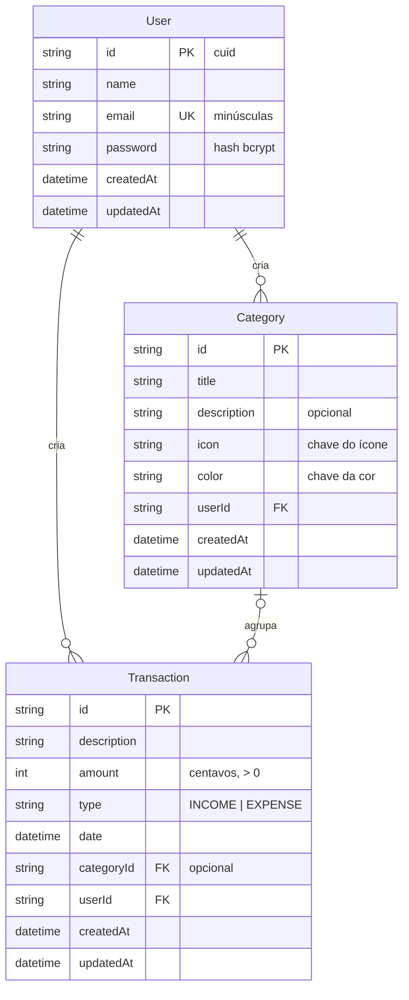

# 03 — Modelo de dados

## Diagrama



## Schema Prisma (alvo)

```prisma
generator client {
  provider = "prisma-client-js"
}

datasource db {
  provider = "sqlite"
  url      = env("DATABASE_URL")
}

model User {
  id           String        @id @default(cuid())
  name         String
  email        String        @unique
  password     String
  createdAt    DateTime      @default(now()) @map("created_at")
  updatedAt    DateTime      @updatedAt @map("updated_at")
  categories   Category[]
  transactions Transaction[]

  @@map("users")
}

model Category {
  id           String        @id @default(cuid())
  title        String
  description  String?
  icon         String
  color        String
  userId       String        @map("user_id")
  user         User          @relation(fields: [userId], references: [id], onDelete: Cascade)
  transactions Transaction[]
  createdAt    DateTime      @default(now()) @map("created_at")
  updatedAt    DateTime      @updatedAt @map("updated_at")

  @@index([userId])
  @@map("categories")
}

model Transaction {
  id          String    @id @default(cuid())
  description String
  amount      Int       // centavos, sempre > 0 (ADR-0003)
  type        String    // "INCOME" | "EXPENSE" (validado na aplicação)
  date        DateTime
  categoryId  String?   @map("category_id")
  category    Category? @relation(fields: [categoryId], references: [id], onDelete: SetNull)
  userId      String    @map("user_id")
  user        User      @relation(fields: [userId], references: [id], onDelete: Cascade)
  createdAt   DateTime  @default(now()) @map("created_at")
  updatedAt   DateTime  @updatedAt @map("updated_at")

  @@index([userId, date])
  @@map("transactions")
}
```

## Invariantes

| # | Invariante | Onde é garantida |
|---|---|---|
| I-1 | `User.email` único e minúsculo | `@unique` + `toLowerCase()` antes de salvar |
| I-2 | `Transaction.amount > 0` | Zod (`z.number().int().positive()`) |
| I-3 | `Transaction.type ∈ {INCOME, EXPENSE}` | Enum GraphQL + Zod (`type` é `String` no banco por portabilidade do SQLite) |
| I-4 | `Transaction.categoryId` aponta para categoria do mesmo `userId` | Resolver (RN-05) |
| I-5 | Deletar categoria → transações ficam com `categoryId = null` | `onDelete: SetNull` (RN-07) |
| I-6 | Deletar usuário remove seus dados | `onDelete: Cascade` |
| I-7 | `Category.icon` e `Category.color` pertencem às listas fixas do design | Zod `z.enum([...])` com as chaves de [05-frontend](05-frontend.md#categorias-ícones-e-cores) |

## Seed (opcional, para avaliação)

`prisma/seed.ts` cria um usuário demo (`demo@financy.com` / `12345678`), ~6 categorias e ~30 transações nos últimos 3 meses, para o Dashboard não abrir vazio. Executado por `npm run db:seed`.
